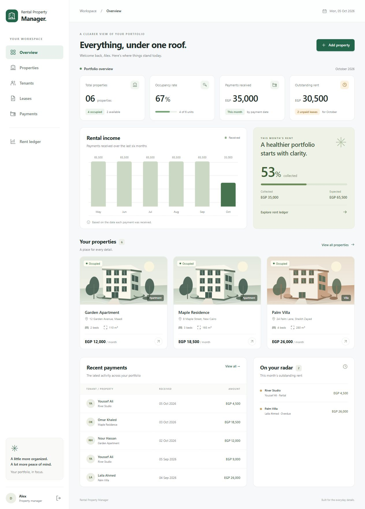

# Rental Property Manager

A Django web application for managing rental properties, tenants, leases, and rent payments, with a responsive dashboard, monthly rent reporting, and CSV export.



## Run locally

Clone this repository and run **setup.cmd** once to install dependencies and create the demo database. Then:

1. Double-click **start.cmd**.
2. Open **http://127.0.0.1:8000** if the browser does not open automatically.
3. Sign in with **demo** / **DemoHome2026!**.

The demo contains fictional people, properties, and payment records. Currency defaults to EGP. The seeded dates are based on the month when the seed command first runs.

The demo account is a normal landlord account. To use Django's administrative interface, create your own administrator with:

```powershell
.\.venv\Scripts\python.exe manage.py createsuperuser
```

Then visit http://127.0.0.1:8000/admin/. The admin site is for trusted system administrators and can access all landlords' data.

## What you can do

- Sign in and sign out using Django's built-in session authentication.
- Add, view, edit, and delete properties, tenants, leases, and payments.
- See occupancy, this month's cash received, and this month's outstanding rent.
- View a six-month income chart and recent payment activity.
- Filter and search records; browse paginated lists.
- Check any month's rent ledger, including paid, partial, overdue, and upcoming rent.
- Record partial or advance rent payments.
- Export your payments as a spreadsheet-friendly CSV.
- Use the responsive interface on desktop or mobile.
- Access a separate private portfolio for each landlord account.

## Technology

| Layer | Choice |
| --- | --- |
| Language | Python 3.12 |
| Backend | Django 5.2.17 LTS |
| Database | SQLite |
| UI | Django templates, custom CSS, vanilla JavaScript |
| Authentication | Django authentication, sessions, CSRF protection |
| Testing | Django TestCase / unittest |
| Artwork | Original local SVG illustrations and icons |

No Node.js, React, external database server, paid service, CDN, or API key is required. The interface works offline after installation.

Django 5.2 supports Python 3.12: [official release notes](https://docs.djangoproject.com/en/5.2/releases/5.2/).

## Setup on Windows

Install Python 3.12 or a compatible Python version first, then double-click **setup.cmd**. It creates a local virtual environment, installs the pinned dependencies, migrates the database, and creates the demo portfolio.

Equivalent PowerShell commands:

```powershell
git clone https://github.com/MohammedAdel2001/rental-property-manager.git
cd rental-property-manager
python -m venv .venv
.\.venv\Scripts\python.exe -m pip install -r requirements.txt
.\.venv\Scripts\python.exe manage.py migrate
.\.venv\Scripts\python.exe manage.py seed_demo
.\.venv\Scripts\python.exe manage.py runserver 127.0.0.1:8000
```

On macOS/Linux, use `python3 -m venv .venv` and `.venv/bin/python` in place of the Windows executable path.

Run `seed_demo` again safely: it does not duplicate an existing demo portfolio or reset an existing account password. To create another landlord, an administrator can add a regular user through the admin site. That user starts with an empty portfolio.

## Business rules

- One property represents one rentable unit.
- A lease belongs to one property and one tenant.
- The property and tenant must belong to the same landlord.
- Lease end dates must be later than start dates.
- Lease dates are inclusive; two leases cannot overlap, including on the same boundary day.
- Asking rent, agreed rent, and payment amounts must be positive.
- A payment belongs to a lease and a calendar rent month. Any selected date is normalized to the first of its month.
- A payment's rent month must fall within its lease.
- Multiple partial payments are allowed; their total cannot exceed that month's agreed rent.
- A payment cannot be marked as received on a future date.
- Rent is charged in full for every calendar month touched by the lease; there is no proration.
- Rent is due on the first day of each month, or the start date for the first month.
- Linked leases and payments prevent accidental cascading deletion.
- A lease with payments cannot be moved to a different property/tenant, shortened to exclude a paid month, or reduced below amounts already collected.

The dashboard's **Payments received** uses the payment receipt date. The ledger's **Collected** uses the rent month. This distinction matters when someone pays early or pays overdue rent.

Outstanding rent on the dashboard is for the current month only. Use the monthly ledger to inspect older balances. Upcoming leases count as available until their start date.

## Tests

Double-click **test.cmd**, or run:

```powershell
.\.venv\Scripts\python.exe manage.py test
.\.venv\Scripts\python.exe manage.py check
.\.venv\Scripts\python.exe manage.py makemigrations --check --dry-run
```

The test suite covers CRUD flows, authentication, per-owner isolation, forged relation IDs, CSRF enforcement, overlapping leases, payment limits, reporting, CSV formula escaping, and repeatable demo seeding. Tests use a separate temporary database and do not alter the demo portfolio.

## Code map

```text
config/                 Django settings and top-level URLs
rentals/
  models.py             Four domain models and business validation
  forms.py              Styled ModelForms with owner-scoped relation choices
  views.py              Authenticated CRUD pages, dashboard, CSV export
  services.py           Month arithmetic and rent ledger calculations
  urls.py               Application routes
  admin.py              Administrator interface
  tests.py              Automated regression tests
  migrations/           Versioned database schema
  management/commands/  Repeatable demo seeding
templates/              Server-rendered pages and reusable components
static/                 Local CSS, JavaScript, SVG artwork
scripts/launch.py       Local launcher
docs/screenshots/       Application screenshots
```


## Configuration

Environment variables are optional for local use:

| Variable | Default |
| --- | --- |
| DJANGO_DEBUG | true |
| DJANGO_ALLOWED_HOSTS | 127.0.0.1,localhost,[::1] |
| RENTAL_CURRENCY | EGP |
| DJANGO_SECRET_KEY | Local-only development key |

`.env.example` is a reference file; it is not automatically loaded. Set variables in your shell before starting the server. Changing RENTAL_CURRENCY changes the display label only, not stored amounts or exchange rates.

## Scope and future improvements

Payments are recorded manually. Online payment processing, reminders, document uploads, rent proration, audit logging, and maintenance tickets are outside the current feature set.

SQLite and application validation suit a small demonstration. Database constraints enforce positive amounts and date ordering, while cross-row overlap and payment-total rules are checked by forms/model validation. Concurrent production writes require stronger transactional locking or PostgreSQL constraints. Django's `save()` does not automatically call `full_clean()`; scripts that create records must validate them, as the demo command does for leases and payments.

Before public deployment, use a new secret, disable debug, remove/change demo credentials, use HTTPS and a production WSGI server, configure static file serving, and arrange database backups. Deployment is intentionally outside the local demo setup.
